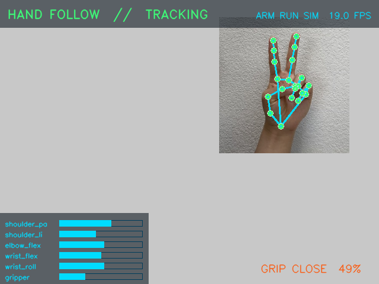
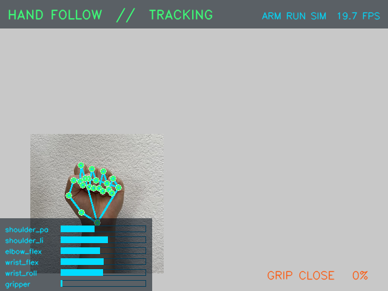
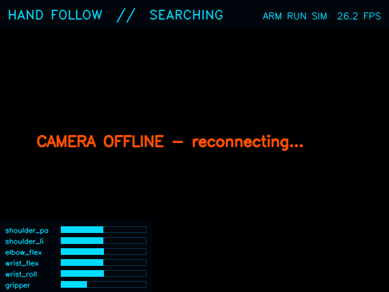

# 따라하기 가이드

이 문서만 보고 처음부터 끝까지 천천히 따라 할 수 있도록 만든 안내서입니다.
순서대로 진행하고, 각 단계의 **확인** 항목이 맞는지 보고 다음으로 넘어가세요.

| 순서 | 내용 | 로봇 필요 |
|---|---|---|
| [1](#1-파일-받기) | 파일 받기 | 아니요 |
| [2](#2-python-설치) | Python 설치 | 아니요 |
| [3](#3-프로그램-설치) | 프로그램 설치 | 아니요 |
| [4](#4-명령-프롬프트-여는-법) | 명령 프롬프트 여는 법 | 아니요 |
| [5](#5-연습-1-로봇-없이-동작-가르치기) | 연습 1: 로봇 없이 동작 가르치기 | 아니요 |
| [6](#6-연습-2-손-인식-체험) | 연습 2: 손 인식 체험 | 아니요 (웹캠만) |
| [7](#7-1회차-실제-로봇에게-동작-가르치기) | 1회차: 실제 로봇에게 동작 가르치기 | 예 |
| [8](#8-2회차-손동작으로-로봇-조종하기) | 2회차: 손동작으로 로봇 조종하기 | 예 |
| [9](#9-문제가-생겼을-때) | 문제가 생겼을 때 | |
| [10](#10-미션-기록지) | 미션 기록지 | |

> 로봇을 처음 연결하는 설정(포트 찾기, 캘리브레이션, 안전 범위)은 선생님이 [SETUP.md](SETUP.md)로 미리 해 둡니다.
> 학생은 5~6번을 연습한 뒤, 수업 시간에 7~8번을 합니다.

---

## 1. 파일 받기

1. 저장소 페이지 https://github.com/kisan2970/sinheung_so101_class 에 들어갑니다.
2. 초록색 **`Code`** 버튼 → **`Download ZIP`** 을 누릅니다.
3. 받은 `sinheung_so101_class-main.zip` 을 마우스 오른쪽 버튼 → **압축 풀기** 합니다.
4. 압축을 푼 폴더를 **`C:\so101`** 로 옮깁니다. 폴더 이름도 `so101`로 바꿉니다.

**확인:** `C:\so101` 안에 `teach.bat`, `hand_follow.bat`, `setup_student.bat` 파일이 보이면 됩니다.

> 바탕화면이나 `다운로드` 폴더처럼 경로에 한글이나 띄어쓰기가 있으면 설치가 실패하는 경우가 있습니다.
> 그래서 `C:\so101`처럼 영어로 된 짧은 경로를 씁니다.

---

## 2. Python 설치

이미 Python 3.10이 깔려 있으면 이 단계는 건너뜁니다. 4번의 방법으로 명령 프롬프트를 열고 아래를 입력해 보세요.

```bat
py -3.10 --version
```

`Python 3.10.x`가 나오면 이미 설치된 것입니다.

**설치 방법 (둘 중 하나)**

- **방법 A — 명령어로 설치:** 명령 프롬프트에 아래를 입력하고 Enter를 누릅니다. 중간에 동의를 물으면 `Y`를 누릅니다.
  ```bat
  winget install -e --id Python.Python.3.10
  ```
- **방법 B — 홈페이지에서 설치:** https://www.python.org/downloads/release/python-31011/ 맨 아래에서 **Windows installer (64-bit)** 를 받아 실행합니다.
  - 첫 화면 아래쪽 **"Add python.exe to PATH"** 에 체크합니다.
  - **Install Now** 를 누릅니다.

설치가 끝나면 **명령 프롬프트를 닫았다가 다시 열고** 버전 확인 명령을 한 번 더 입력합니다.

**확인:** `Python 3.10.x`가 나오면 됩니다.

---

## 3. 프로그램 설치

`C:\so101` 폴더에서 아래 파일을 **더블클릭**합니다.

| 이 PC가 | 실행할 파일 | 받는 용량 | 걸리는 시간 |
|---|---|---|---|
| 로봇 없이 연습만 하는 PC (학생 노트북) | `setup_student.bat` | 약 300MB | 3~5분 |
| 로봇을 연결하는 PC (수업용) | `setup_windows.bat` | 약 3GB | 10~20분 |

검은 창에 글자가 계속 올라가면 정상입니다. 끝나면 **환경 점검** 결과가 나옵니다.

```
[ OK ] Python                 3.10.11 ...
[WARN] torch                  없음 ...
[ OK ] mediapipe              0.10.21
[WARN] Servo boards           서보 보드로 보이는 포트 없음 (연습용 PC 는 정상)
[ OK ] Cameras                #0 640x480
```

**확인:** `[FAIL]` 이 없으면 됩니다. `[WARN]`은 괜찮습니다.

- `setup_student.bat`에서는 torch, lerobot, Servo boards가 `[WARN]`으로 나오는데, 이것이 정상입니다.
- `Cameras`가 `[FAIL]`이면 다른 프로그램(Zoom, 카메라 앱 등)이 웹캠을 쓰고 있는지 확인하세요.
- 오류가 나서 멈췄다면 창을 닫지 말고 [9번](#9-문제가-생겼을-때)을 보세요.

---

## 4. 명령 프롬프트 여는 법

`teach.bat` 뒤에 옵션(`--sim` 등)을 붙여서 실행하려면 명령 프롬프트가 필요합니다.

1. 파일 탐색기에서 `C:\so101` 폴더를 엽니다.
2. 위쪽 **주소창**을 한 번 클릭합니다.
3. `cmd` 라고 입력하고 Enter를 누릅니다.

**확인:** 검은 창이 열리고 `C:\so101>` 이 보이면 됩니다. 이 창에 명령을 입력합니다.

> **한/영 키를 영어로!** 프로그램을 쓰는 동안에는 키보드를 영어 입력 상태로 두세요.
> (동작 가르치기 프로그램은 한글 상태여도 대부분 동작하게 만들어 두었지만, 손 인식 창은 영어 상태여야 합니다.)

---

## 5. 연습 1: 로봇 없이 동작 가르치기

가상 로봇으로 키 사용법을 익힙니다. 실제 수업에서 쓰는 키와 똑같습니다.

### 5-1. 실행

명령 프롬프트에 입력합니다.

```bat
teach.bat practice --sim
```

아래와 같은 키 안내 상자가 나오고, 맨 아랫줄에 상태가 표시됩니다.

```
[RUN] 자세 0개 속도 0.6 반복 off | idle | [1:+0] 2:+0 3:+0 4:+0 5:+0 6:+30
```

| 아랫줄 | 뜻 |
|---|---|
| `[RUN]` | 로봇 상태 (`RUN` 정상, `ESTOP_HOLD` 비상정지, `HOLD_HOME` 정지 후 대기) |
| `자세 0개` | 지금까지 저장한 자세 수 |
| `속도 0.6` | 재생 속도 (0.1 ~ 1.0) |
| `1:+0` ~ `6:+30` | 관절 1~6의 각도. 6번은 그리퍼가 열린 정도 |
| `[1:+0]` | 대괄호 = 지금 선택된 관절 |

관절 번호: **1** 몸통 회전, **2** 어깨, **3** 팔꿈치, **4** 손목 굽히기, **5** 손목 돌리기, **6** 그리퍼

> 연습 모드에는 `--sim`이 붙어 있어서 leader 팔 대신 **키보드**로 관절을 움직입니다.
> `1`~`6`으로 관절을 고르고, `a`는 − 방향, `d`는 + 방향입니다. 한 번 누를 때마다 3도씩 움직입니다.

### 5-2. "고개 흔들기" 프로그램 만들기

아래 표를 한 줄씩 그대로 따라 하세요.

| 단계 | 누를 키 | 아랫줄 / 화면에 보이는 것 |
|---|---|---|
| 1 | `1` | `[1:+0]` (1번 관절 선택) |
| 2 | `d`를 10번 | `[1:+30]` |
| 3 | `s` | `> 자세 1 저장!` |
| 4 | `a`를 20번 | `[1:-30]` |
| 5 | `s` | `> 자세 2 저장!` |
| 6 | `w` `w` | `> 기다리기 1.0초` |
| 7 | `d`를 10번 | `[1:+0]` |
| 8 | `o` | `6:+60` (그리퍼 열림) |
| 9 | `s` | `> 자세 3 저장!` |
| 10 | `c` | `6:+2` (그리퍼 닫힘) |
| 11 | `s` | `> 자세 4 저장!` |
| 12 | `p` | `1/5 자세로 이동` → `2/5 …` → `3/5 대기` → `4/5` → `5/5` → `완료` |

**확인:** 12단계에서 1번 관절 숫자가 +30 → −30 → (잠시 멈춤) → 0 으로 바뀌고, 6번이 60 → 2 로 바뀌면 성공입니다.

### 5-3. 다른 키도 눌러 보기

| 해 볼 것 | 키 | 결과 |
|---|---|---|
| 빠르게 재생 | `+` 여러 번 → `p` | 속도 1.0까지 올라가고 더 빨리 끝남 |
| 반복 재생 | `l` → `p` | `반복 ON`, 계속 반복. 멈출 때는 `p` |
| 비상정지 | 재생 중 `SPACE` | `> 비상정지! …` → `ESTOP_HOLD` → `HOMING` → `HOLD_HOME` |
| 다시 시작 | `r` | `[RUN]` 으로 돌아옴 |
| 마지막 단계 지우기 | `u` | `> 마지막 단계 삭제`, 자세 수가 하나 줄어듦 |
| 전체 지우기 | `x` 를 빠르게 두 번 | `> 전체 삭제됨` |
| 끝내기 | `q` | `저장됨: C:\so101\programs\practice.json` |

같은 이름으로 다시 실행하면 `기존 프로그램 'practice' 불러옴: 자세 4개`가 나오고 이어서 할 수 있습니다.
프로그램은 `programs` 폴더에 **자동 저장**됩니다. 따로 저장 키를 누를 필요가 없습니다.

---

## 6. 연습 2: 손 인식 체험

웹캠으로 손을 인식하는 AI를 체험합니다. 로봇은 가상입니다.

```bat
hand_follow.bat --sim
```

1. 창이 열리면 **창을 한 번 클릭**합니다. 키가 이 창으로 들어가게 하기 위해서입니다.
2. 웹캠에서 50cm~1m 떨어져서 손바닥을 카메라 쪽으로 보입니다.
3. 손에 점 21개와 선이 그려지고, 위쪽 글자가 `TRACKING`으로 바뀝니다.



| 해 볼 것 | 보이는 것 |
|---|---|
| 손을 좌우로 움직이기 | 왼쪽 아래 `shoulder_pan` 막대가 움직임 |
| 손을 위아래로 움직이기 | `shoulder_lift`, `elbow_flex` 막대가 움직임 |
| 주먹 쥐기 | 오른쪽 아래 `GRIP CLOSE`, `gripper` 막대가 줄어듦 |
| 손 펴기 | `GRIP OPEN` |
| 손을 화면 밖으로 빼기 | `SEARCHING`, 막대들이 천천히 처음 위치로 |



**창 키:** `SPACE` 비상정지, `r` 재개, `p` 따라하기 멈춤, `m` 좌우 반전, `f` 전체 화면, `q` 종료

**확인:** 주먹을 쥐었다 폈다 할 때 `GRIP CLOSE` / `GRIP OPEN`이 바뀌면 성공입니다.

---

## 7. 1회차: 실제 로봇에게 동작 가르치기

선생님이 로봇을 연결하고 설정해 둔 수업용 PC에서 합니다.

### 7-1. 시작 전 확인

- [ ] follower 팔 전원(어댑터)과 USB, leader 팔 USB가 꽂혀 있다
- [ ] 작업 구역 안에 손이나 물건(큐브와 컵 빼고)이 없다
- [ ] **비상정지 담당**이 키보드 앞에 있다 (이상하면 `SPACE`)

### 7-2. 실행

`C:\so101` 폴더의 `teach.bat`을 더블클릭하고 팀 이름을 입력합니다(영어/숫자, 예: `team1`). 또는 명령 프롬프트에서:

```bat
teach.bat team1
```

처음에는 follower가 leader 팔 자세 쪽으로 **천천히** 이동합니다. 그다음부터는 leader 팔을 움직이면 follower가 따라옵니다.

### 7-3. 미션: 큐브를 컵에 넣기

먼저 종이에 순서를 적고 시작하세요. 아래는 예시입니다.

| 자세 | leader 팔로 할 것 | 그다음 누를 키 |
|---|---|---|
| 1 | 큐브 **바로 위** (5cm 위), 그리퍼 열기 | `s` |
| 2 | 그대로 **내려가서** 큐브를 감싸기 | `s` |
| 3 | 그리퍼 **닫기** | `s`, 그리고 `w` (닫힐 시간) |
| 4 | 큐브를 든 채 **위로 들기** | `s` |
| 5 | **컵 위**로 이동 | `s` |
| 6 | 그리퍼 **열기** | `s`, 그리고 `w` |
| 7 | 위로 빠져나오기 | `s` |

그다음 **로봇이 컵에 넣은 큐브를 다시 처음 자리에 놓고** `p`를 누릅니다.

> 처음 재생할 때는 `-`를 눌러 **속도를 0.3**으로 낮추세요. 잘 되면 조금씩 올립니다.

**잘 안 될 때**

| 증상 | 해결 |
|---|---|
| 큐브를 옆으로 밀고 감 | 1번(큐브 바로 위) 자세를 빼먹었는지 확인. 위에서 수직으로 내려가야 함 |
| 들다가 떨어뜨림 | 3번 다음에 `w`를 더 넣기, 속도 낮추기 |
| 컵 가장자리에 부딪힘 | 4번을 더 높게, 5번을 컵 정중앙 위로 |
| 잘못 저장함 | `u`로 마지막 것 지우고 다시 |
| 로봇이 멈칫하고 다음으로 안 감 | 무언가에 막혀서 안전 기능이 작동한 것. 그 자세를 조금 높게 다시 저장 |

### 7-4. leader 팔이 없을 때

```bat
teach.bat team1 --input keys
```

5번 연습처럼 키보드로 움직입니다. `o` / `c`로 그리퍼를 엽니다/닫습니다.

```bat
teach.bat team1 --input hand
```

`t`를 누르면 토크가 꺼져서 follower 팔을 **손으로 직접** 움직일 수 있습니다.
**`t`를 누르기 전에 반드시 팔을 손으로 잡으세요.** 안 잡으면 팔이 떨어집니다.
`p`를 누르면 자동으로 토크가 켜지고 재생합니다.

### 7-5. 발표

```bat
teach.bat team1 --play
```

저장된 프로그램이 바로 재생되고, 끝나면 프로그램이 종료됩니다. 계속 반복하려면 `--loop`을 붙입니다.

```bat
teach.bat team1 --play --loop
```

---

## 8. 2회차: 손동작으로 로봇 조종하기

선생님이 미리 `hand_follow.py --setup`으로 손 높이에 맞는 팔 자세를 기록해 둔 PC에서 합니다.

```bat
hand_follow.bat
```

1. 창을 클릭하고, 키보드는 **영어** 상태로 둡니다.
2. 카메라 앞 50cm~1m에서 손바닥을 보입니다.
3. 손이 4번 연속으로 인식되면 `TRACKING`이 되고 로봇이 **천천히** 따라오기 시작합니다.

| 손 | 로봇 |
|---|---|
| 좌우 | 몸통 회전 |
| 위아래 | 팔 들기 / 내리기 |
| 손목 기울이기 | 손목 돌리기 |
| 주먹 / 펴기 | 그리퍼 닫기 / 열기 |

- **천천히** 움직이세요. 로봇에는 속도 제한이 있어서 손을 빨리 움직여도 로봇은 천천히 따라옵니다.
- 손을 화면 밖으로 빼면 로봇이 천천히 처음 자세로 돌아갑니다. 교대할 때 이렇게 하면 됩니다.
- 위험하면 `SPACE`를 누릅니다. 멈췄다가 처음 자세로 돌아가고, `r`을 누르면 다시 시작합니다.

**대결:** 큐브를 컵에 넣는 데 걸린 시간을 leader 팔과 손동작으로 각각 재서 [10번 기록지](#10-미션-기록지)에 적습니다.

---

## 9. 문제가 생겼을 때

| 증상 | 원인 / 해결 |
|---|---|
| `'py'은(는) 내부 또는 외부 명령 … 이 아닙니다` | Python이 설치되지 않음 → [2번](#2-python-설치). 설치 후 명령 프롬프트를 다시 열기 |
| `Python 3.10 이 없습니다` | 다른 버전만 있음 → 3.10을 추가로 설치 |
| 설치 중 빨간 글씨로 멈춤 | 인터넷 연결 확인 후 `setup_*.bat` 다시 실행. 그래도 안 되면 화면을 찍어서 선생님께 |
| `teach.bat`을 실행하면 바로 꺼짐 | 설치가 안 된 것 → [3번](#3-프로그램-설치) |
| 키를 눌러도 반응이 없음 | 검은 창(또는 손 인식 창)을 한 번 클릭. 한/영을 영어로 |
| `leader 팔에 연결하지 못했습니다` | leader USB 확인. 없으면 `--input keys` 사용 |
| `로봇 연결 실패` / 화면에 `ROBOT LINK LOST` | follower 전원과 USB 확인. 다시 꽂으면 자동으로 다시 연결됨 |
| `[HOLD_HOME]` 에서 움직이지 않음 | 비상정지 후 대기 상태 → `r` |
| `CAMERA OFFLINE` | 웹캠을 다른 앱이 사용 중. 그 앱을 끄면 자동으로 다시 연결됨 |
| 손을 잘 못 찾음 | 밝은 곳에서, 뒤에 창문(역광) 없이, 배경은 단순하게 |
| 손 인식 창에서 좌우가 반대 | `m` 키 |



---

## 10. 미션 기록지

공책에 옮겨 적거나 인쇄해서 쓰세요.

**1회차: 동작 가르치기**

| 팀 | 미션 | 저장한 자세 수 | 재생 속도 | 성공 / 시도 | 발견한 점 |
|---|---|---|---|---|---|
| | LV1 컵에 넣기 | | | / | |
| | LV2 쌓기 | | | / | |
| | LV3 도미노 | | | / | |

**큐브를 2cm 옮기고 다시 재생하면?** 결과: ______________ 이유: ______________

**2회차: leader 팔 vs 손동작**

| 이름 | leader 팔 (초) | 손동작 (초) | 더 쉬웠던 쪽과 이유 |
|---|---|---|---|
| | | | |
| | | | |
| | | | |

**손 인식이 실패한 상황:** ______________
